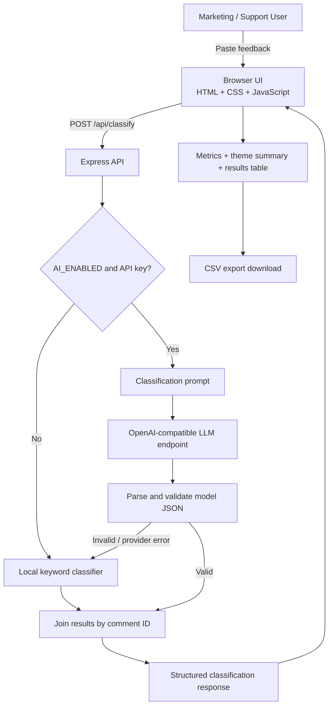

# Architecture & Design

## 1. High-level architecture



## 2. Component responsibilities

| Component | File | Responsibility |
|---|---|---|
| Presentation | `public/index.html` | Semantic page structure, input, controls, result containers |
| Styling | `public/styles.css` | Responsive layout, colors, cards, tables, status badges |
| Browser controller | `public/app.js` | Input parsing, API call, rendering, filtering, CSV generation |
| HTTP/API layer | `server.js` | Static hosting, request validation, AI provider integration, fallback |
| Prompt | `server.js` (`SYSTEM_PROMPT`) | Defines sentiment labels, theme output, rationale and JSON contract |
| Demo dataset | `data/sample_feedback.txt` | Thirty retail-product comments for repeatable evaluation |
| Configuration | `.env.example` | Optional provider settings and server port |

## 3. Request / response contract

### Request

`POST /api/classify`

```json
{
  "comments": [
    { "id": "FB-001", "text": "The product is excellent." },
    { "id": "FB-002", "text": "Delivery was late." }
  ]
}
```

### Response

```json
{
  "mode": "local",
  "results": [
    {
      "id": "FB-001",
      "sentiment": "positive",
      "confidence": 0.68,
      "themes": ["General feedback"],
      "rationale": "Local keyword-based estimate; review the original comment for context."
    }
  ]
}
```

`mode` can be `local`, `ai`, or `local-fallback`. The frontend uses `id` to match the analysis result to the original comment, rather than relying on response ordering.

## 4. Classification prompt design

The backend system prompt requires:
- Exactly one sentiment label: positive, neutral, or negative.
- Independent classification for each comment.
- A confidence estimate between zero and one.
- One to three short themes.
- A short rationale grounded in the supplied text.
- JSON-only output with the original comment ID.

Low temperature is used to reduce response variation. The server validates labels and IDs and falls back per-comment when a record is missing or malformed.

## 5. Metric definitions

- **Positive / Neutral / Negative counters:** number of comments assigned each class.
- **Sentiment mix:** each class count divided by total comments.
- **Brand health:** `(positive + 0.5 × neutral) / total × 100`, rounded to an integer.
- **Top themes:** most frequent theme labels, counting a label once per returned comment-theme assignment.

These are descriptive indicators for a batch, not statistically representative brand measures. The dashboard does not infer review volume outside the supplied batch.

## 6. Privacy and security boundaries

- Static browser assets contain no API credentials.
- The optional AI key is stored in a server-side `.env` file.
- No database or browser local storage is used; comments remain in page memory for the active session.
- AI mode transmits submitted comment text to the configured model provider. Obtain authorization and follow applicable privacy / retention requirements.
- Starter implementation omits authentication, rate limiting, abuse protection, and persistent audit logs. Add them before production use.

## 7. Failure handling

1. Invalid request shape or more than 200 comments: HTTP 400.
2. AI provider failure: server logs the error and returns local fallback results.
3. Missing model result or unsupported sentiment label: local fallback for that comment.
4. Browser cannot reach API: browser-side local classifier renders results.
5. Empty input: browser prompts the user and does not send a request.

## 8. Deployment topology

For a hackathon demo, run the Node server on one machine and open the localhost URL. For hosted use, deploy the Node service behind HTTPS on a managed Node platform. Configure secrets using the platform's secret manager, not a committed `.env` file. Add authentication, rate limiting, request-size controls, data-retention policy, and monitoring before production.
